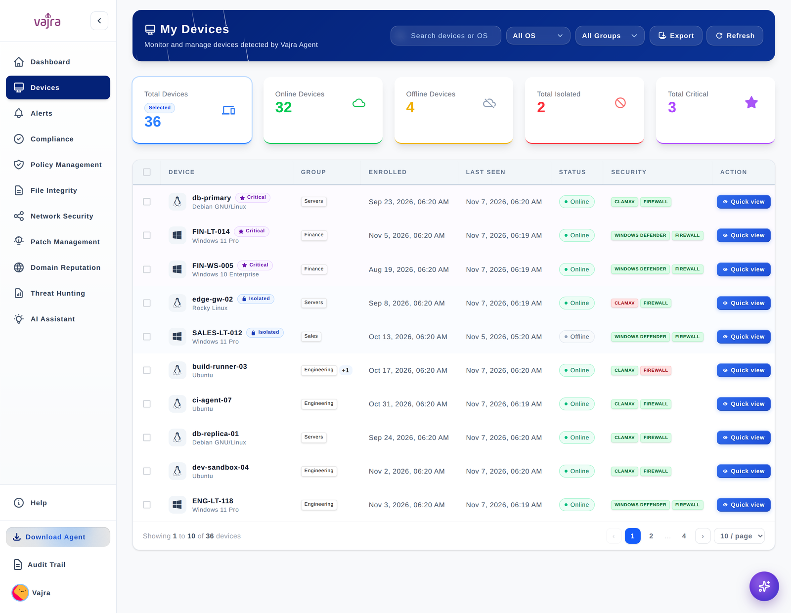

<h1 align="center">
  <picture>
    <source media="(prefers-color-scheme: dark)" srcset=".github/assets/logo-dark.svg">
    
  </picture>
</h1>

<p align="center">
  <b>The open-source endpoint security platform</b> for Linux and Windows, on your own servers.
</p>

<p align="center">
  <picture>
    <source media="(prefers-color-scheme: dark)" srcset=".github/assets/tagline-dark.svg">
    
  </picture>
</p>

<p align="center">
  <a href="LICENSE"></a>
  
  <a href="https://github.com/VajraSecurity/vajra/actions/workflows/server-ci.yml"></a>
  <a href="https://github.com/VajraSecurity/vajra/actions/workflows/console-ci.yml"></a>
  
  
</p>

<p align="center">
  <a href="#quick-start">Quick start</a> ·
  <a href="docs/install.md">Install guide</a> ·
  <a href="docs/agents.md">Agents</a> ·
  <a href="docs/production.md">Production</a> ·
  <a href="https://vajranet.com">Website</a>
</p>

<p align="center">
  
</p>

##  Why Vajra

Vajra puts endpoint agents, a detection engine and a web console in one repository that you run
yourself. Agents collect telemetry with [osquery](https://osquery.io); a C++ engine correlates it
into alerts; the console covers hunting, compliance, vulnerabilities, patching and device control.

- **Compared with osquery on its own**, Vajra adds enrollment, detection rules and a console for the
  alerts they raise.
- **Compared with a full SIEM or XDR suite**, it is smaller and endpoint-only: one compose file
  starts the whole stack on one machine.

##  Features

- **Threat detection**: correlation over process, file, socket, DNS, registry, eBPF and audit
  events, with a bundled ruleset partly converted from Sigma.
- **Alerts and hunting**: triage and assignment, analytics, AI-assisted analysis, and live osquery
  SQL across every host.
- **Compliance**: snapshots, history and PDF reports, including the SEBI and IRDAI frameworks.
- **Vulnerabilities and patching**: host CVEs, Nessus, OpenVAS and Burp Suite imports, Windows patch
  jobs and signed Linux patch bundles.
- **Device control**: USB, Bluetooth, port and IP policies per device or group, plus inventory of
  programs, ports, firewall and hardware.
- **Network Security** and **Domain Reputation**.
- **Access**: roles, teams, MFA with recovery codes and an audit trail.
- **Clean removal**: uninstalling an agent or the server restores what was there before.

###  What's open and what isn't

The server, detection engine, console, installers and ruleset are MIT licensed and in this
repository. The agent extensions are prebuilt binaries whose source is not published, and the FIM
worker and Rule Engine console are not included.

##  Quick start

**Requirements:** Docker with the Compose plugin (or Ubuntu/Debian for the script install), 8 GB RAM
and about 20 GB of free disk. The first build takes around 5 minutes on an 8-core machine. Your
endpoints need to reach the server on ports 1234, 4000 and 8080.

```bash
git clone https://github.com/VajraSecurity/vajra && cd vajra
./docker/init-env.sh              # writes .env with random secrets and this machine's IP
docker compose up -d --build      # the first build compiles the C++ server
./docker/create-admin.sh          # prints the first admin's one-time password
```

Open `http://<your-ip>:8080` and sign in with the password it printed.

<details>
<summary><b>Install without Docker</b> (Ubuntu or Debian)</summary>

```bash
./install.sh                      # installs everything with sudo; prints the URLs at the end
./install.sh --host 10.0.0.5      # the same, with an address you choose
```

The first admin's one-time password is printed and saved in `admin-credentials.txt`. Use one
install method per machine: both use the same ports.

</details>

###  Add an endpoint

Your Vajra server builds both agent packages for you. Download them from **Download Agent** in the
console sidebar. Each package already contains your server's address, its CA certificate and the enrollment secret.

| Platform | Install |
|---|---|
| Linux | Unzip, then `sudo ./vajra_install.sh -install` inside `linux_agent/` |
| Windows 7–11, 64-bit | Unzip, then run `vajra_install.bat` as administrator inside `windows_agent\` |

The host appears in the console within a minute or two.

##  Documentation

| Guide | What it covers |
|---|---|
| [Install](docs/install.md) | Docker and script installs, ports, start, stop and logs |
| [Agents](docs/agents.md) | Packages, install options, removing an agent |
| [Production](docs/production.md) | HTTPS, agent mTLS, network exposure, secrets and backups |
| [Uninstall](docs/uninstall.md) | Removing the server and how packages are handled |
| [Troubleshooting](docs/troubleshooting.md) | Console problems, hosts that don't appear, Windows installer errors |

<details>
<summary><b>Repository layout</b></summary>

| Folder | What it is |
|---|---|
| [`vajranet_server/`](vajranet_server) | Web console (React) and API (Node.js) |
| [`vajra_server/`](vajra_server) | C++ server that agents enroll with, and the detection engine |
| [`linux_agent/`](linux_agent) | Linux agent installer and packaging |
| [`windows_agent/`](windows_agent) | Windows agent installer and packaging |
| [`docker/`](docker) | Helper scripts for the Docker setup |

</details>

##  FAQ

<details>
<summary><b>Is Vajra free?</b></summary>

Yes. This edition is MIT licensed. Vajra Enterprise adds hardened security and professional
support; see [vajranet.com](https://vajranet.com).

</details>

<details>
<summary><b>Is it ready for production?</b></summary>

Not out of the box. The default setup is for one machine on a trusted network, and the console uses
plain HTTP. Work through [Production hardening](docs/production.md) first.

</details>

<details>
<summary><b>How do I remove it?</b></summary>

Run `./docker/cleanup.sh` (Docker) or `./uninstall.sh` (script). Agents are removed on each machine
with the uninstaller in their package. See [Uninstall](docs/uninstall.md) and
[Remove an agent](docs/agents.md#remove-an-agent).

</details>

##  Security

Please don't open public issues for security problems. Report them privately as described in
[SECURITY.md](SECURITY.md).

> [!CAUTION]
> This open-source edition is provided as is, without warranty or support, and Vajra Security is not
> responsible for any damage or breach that comes from using it. For hardened security and support,
> use **Vajra Enterprise**: [vajranet.com](https://vajranet.com).

##  Contributing

Read [CONTRIBUTING.md](CONTRIBUTING.md) and the [Code of Conduct](CODE_OF_CONDUCT.md), then pick an
[open issue](https://github.com/VajraSecurity/vajra/issues). Bug reports and feature requests are
welcome.

##  License

MIT, see [LICENSE](LICENSE). Third-party components are listed in each folder's `THIRD_PARTY.md`.

<p align="center"></p>

<p align="center">
  <picture>
    <source media="(prefers-color-scheme: dark)" srcset=".github/assets/logo-dark.svg">
    
  </picture>
  <br>
  <sub>Built by <a href="https://vajranet.com">Vajra Security</a> ·
  <a href="SECURITY.md">Security</a> ·
  <a href="https://github.com/VajraSecurity/vajra/issues">Issues</a></sub>
</p>
